# A2A 腺苷受体拮抗剂智能虚拟筛选与 MD 候选 · 参赛代码（区赛）

第一届全球大学生生命科学挑战赛 · 研究生组 · **赛道三：离子通道、GPCR 等药靶的小分子药物虚拟筛选**

本包是参赛项目的**原始代码与实际运行结果**，按赛事《代码提交要求》（附件 5）组织：
`README.md` / `requirements.txt` / `environment.yml` / `data/` / `src/` / `models/` /
`notebooks/` / `results/` / `logs/`，并提供一键入口 `run.sh` 与主运行入口 `predict.py`。

---

## 1. 一句话说明

在人源腺苷 A2A 受体（ADORA2A，PDB **4EIY**，拮抗剂方向）上，用**同一套冻结筛选规则**
（`SOP-05-A2A-antagonist-shortlist v1.7.0`）跑通两条**互斥分子来源**的漏斗，再把两条链的
MD 一级批次并池重解，产出 **20 个 MD 候选 + 2 个共用阴性对照**的最终名册：

| 来源 | 分子来源 | 漏斗入口 → MD 一级批次 | 候选 |
|---|---|---|---|
| **SOP_5** | 目录化合物（ZINC / MCULE） | 4,990 池 → 50 名单 → 批次 20 席 | 18 + 2 对照 |
| **SOP_ML_run05** | ML 生成分子（SCALE-） | 4,979 池 → 34 名单 → 批次 19 席 | 17 + 2 对照 |
| **联立合并层** | 上两条链并池后**重解** | 合并池 35 → 资格池 33 → 重解 20 席 | 20 + 2 共用对照 |

两条链的 MD 一级批次候选按 InChIKey 核对**结构零重叠**，因此合并是「两个互斥来源取并集」，
不是同一批分子的重复计数。

---

## 2. 快速开始

```bash
# 环境：Python 3.12（实测 3.12.2），纯 CPU，无 GPU/CUDA 依赖
python3 -m pip install -r requirements.txt        # 或 conda env create -f environment.yml

# 一键：复跑「MD 候选选择 → 联立合并 → 出候选清单」并与随包冻结清单核验
bash run.sh                    # 约 2–4 分钟（统一用 bash 调用，不依赖解压后的可执行位）
./run.sh                        # 等价；若解压后保留了可执行位可直接执行
bash run.sh --check             # 只做环境自检
bash run.sh --full              # 完整两链（需先按 data/DATA_SOURCES.md 恢复上游原始输入）

# 主运行入口（附件 5 §二(2)）：一键生成标准化最终结果文件
python3 predict.py                        # → results/results.csv + results/results.xlsx
python3 predict.py --source repro         # 用 src/ 下复跑产出生成 → results/reproduced/
python3 predict.py --verify A.csv B.csv   # 逐行逐字段核验两份清单

# 可选（附件 5 §二(3)）：复训 M2 初筛模型，随包提供训练入口与训练/验证数据
python3 train.py                          # → models/a2a_rf_trained_portable.npz
```

`run.sh` 默认模式**不需要任何外网与上游大文件**：它用随包发布的中间产物复跑选择层与合并层，
并断言复跑结果与冻结清单逐行逐字段一致（见 §6）。

---

## 3. 目录结构

```
├── README.md                    本文件
├── requirements.txt             依赖与版本（附件 5 §一(1)）
├── environment.yml              conda 等价环境
├── run.sh                       一键入口
├── predict.py                   主运行入口：生成 results.csv / results.xlsx
├── train.py                     M2 初筛模型训练入口（ECFP4-2048 × 400 棵树 → 纯 numpy 权重）
├── data/
│   ├── DATA_SOURCES.md          数据来源、版本、许可、获取方式与 sha256（附件 5 §三）
│   ├── manifests/               输入清单与哈希（可核验）
│   ├── dataset_train.csv        M2 训练集（1,307 条：479 活性 + 828 阴性，随包自有数据）
│   ├── dataset_external.csv     M2 外部验证集（2,167 条：167 新化学型 + 2,000 诱饵）
│   └── example/                 小规模示例数据（供演示与冒烟测试）
├── src/
│   ├── SOP_5/                   目录化合物链完整工程包（19 步，run_all.py 一键复跑）
│   ├── SOP_ML_run05/            生成分子链完整工程包（同源脚本，只换输入表 + 换表工具）
│   └── （联立合并层代码在）src/SOP_5/10_final_md/
├── models/
│   ├── MODEL_CARD.md            各模型/打分器说明、版本、适用范围与已知局限
│   ├── MODEL_CARD_A2AR-RF-v2.md A2AR-RF-v2 完整模型卡（含外部独立集性能读数）
│   ├── a2a_rf_v2_portable.npz   M2 主权重（纯 numpy 便携包，4.59 MB）
│   ├── a2a_rf_trained_portable.npz  train.py 的导出权重
│   └── a2a_rf_portable.npz      早期便携权重
├── notebooks/
│   └── md_candidates_walkthrough.ipynb   可执行 Notebook：选批 → 合并 → 出清单全流程
├── results/
│   ├── results.csv              标准化候选清单（UTF-8）★ 主结果文件
│   ├── results.xlsx             同内容 Excel
│   ├── README.md                清单字段字典与口径
│   ├── SOP_5/                   该链 MD 批次全字段表 + 说明 + 图
│   ├── SOP_ML_run05/
│   ├── merged_final_md/         合并层名册（20+2）、落选明细、最优性证书、结构卡图
│   ├── structures_3d/           三维结构文件（PDB/CIF/SDF，附件 5 §四；含 8 个结构文件与说明）
│   └── reproduced/              run.sh 复跑产出的清单（用于一致性核验，非提交内容）
└── logs/
    ├── RUN_RECORD.md            交付前复跑与核验记录
    ├── train.log                M2 训练日志（2026-09-18）
    └── run.log                  run.sh 最近一次运行日志
```

**关于 `src/SOP_5/10_final_md/`**：联立合并层是**派生分析层**，挂在 SOP_5 包内
（脚本按包根相对定位，另一条链的包根由 `SOPML_ROOT` 环境变量或同级目录自动解析，
无硬编码绝对路径）。

**关于 `src/features.py`、`src/metrics.py`、`src/__init__.py`**：这三者只为训练入口 `train.py`
服务（ECFP4 指纹与富集指标实现，导入路径 `src.features` / `src.metrics`），默认复跑链路不调用。

---

## 4. 主结果文件字段（`results/results.csv`）

61 行 × 31 列 = 三套清单并排（SOP_5 20 行 / SOP_ML_run05 19 行 / 合并层 22 行），
候选 55 席 + 阴性对照 6 席；三套合计**唯一分子 37 个**。

| 字段 | 含义 |
|---|---|
| `candidate_id` | 候选编号（`S5-01…` / `ML-01…` / `MG-01…`，按清单位次） |
| `track` | 所属赛道（赛道三） |
| `source_set` | 来源集合：`SOP_5` / `SOP_ML_run05` / `merged_final_md` |
| `source_branch` | 分子来源类型：目录化合物（ZINC/MCULE）/ ML 生成分子（SCALE-） |
| `molecule_id` | 原始分子编号 |
| `role` | `候选` / `阴性对照（不占名额）` |
| `smiles` | 结构（SMILES） |
| `cnn_vs` | **关键预测指标**：gnina `CNN_VS = CNNscore × CNNaffinity`（越大越好） |
| `qed` / `cns_mpo` / `mw` / `clogp` / `tpsa` / `hbd` / `hba` / `rotb` | 类药性与 CNS 相关理化量 |
| `herg_prob_admet_ai` / `herg_gate_admet_ai` | ADMET-AI hERG 概率与冻结门（<0.5 过门）判定 |
| `herg_prob_cross_model_ens` | 第二 hERG 模型（ChEMBL 自建集成）概率——**仅作标注，不作判据** |
| `chemotype` / `scaffold_generic` | 化学型与 Bemis-Murcko 通用骨架 |
| `anchor_hits_4A` / `pose_gate` | 姿态闸门：4 锚点命中数与门结果 |
| `sa_score` / `triage_band` | 可合成性启发式分与分诊带（**非判据**，只在合并层给出） |
| `selection_reason` / `md_eligibility_note` | 入席理由 / 「模型依赖」等逐分子标注 |
| `rule_set` / `model_ref` / `run_version` | 规则集版本、模型与版本、运行版本 |
| `remark` | 备注 |

数值精度：`cnn_vs` 4 位小数、`qed` 4 位、`cns_mpo` 3 位、`herg_prob*` 4 位、
`mw` 2 位、`clogp` 3 位、`tpsa` 2 位、`sa_score` 3 位。

---

## 5. 方法与结果要点

**规则与门（两条链完全一致，v1.7.0）**

```mermaid
flowchart LR
  A["上游 gnina 对接<br/>最优姿态"] --> B["结构身份 QC<br/>InChIKey 去重"]
  B --> C["类药性硬门<br/>PAINS0∧Ro5∧Veber"]
  C --> D["姿态闸门<br/>锚点 4/4"]
  D --> E["相似度门<br/>maxTc < 0.90"]
  E --> F["QED 分层<br/>主池 QED ≥ 0.50"]
  F --> G["hERG 门<br/>ADMET-AI < 0.5"]
  G --> H["novelty 门<br/>剔 ChEMBL 已知配体"]
  H --> I["名单层<br/>骨架/化学型/成对 Tc"]
  I --> J["MD 一级批次<br/>MILP 字典序最优"]
  J --> K["并池重解<br/>20 席最终名册"]
```



**选批目标（`frozen_rule.step6_md_batch`，v1.7.0 起为可证明最优）**：在配额可行域内用 MILP
（`scipy.optimize.milp`，HiGHS 后端）按**字典序**最大化 ——
① 分层覆盖下限 `t`（CNN_VS / cLogP / CNS MPO 三轴各 4 分位 = 12 格）→
② CNN_VS 跨度 → ③ Σ CNN_VS → ④ 规范并列打破；每阶段要求 `status=0`、`mip_gap=0`，
且目标值须等于名册实算值。

| 读数 | SOP_5 链 | SOP_ML_run05 链 | 联立合并层 |
|---|---:|---:|---:|
| 名册规模 | 20（18 候选 + 2 对照） | 19（17 + 2） | 22（20 + 2） |
| 分层覆盖下限 `t*` | 4（12/12 格占满） | 3（12/12 格占满） | 5（12/12 格占满） |
| CNN_VS 跨度 | 0.7337 | 3.5015 | 3.5015 |
| Σ CNN_VS | 136.5031 | 119.7563 | 150.4726 |
| 来源构成 | 目录 18 | 生成 17 | 目录 13 + 生成 7 |
| 重解一致 | 是 | 是 | 是 |

**必须随结果转述的边界**

1. 本清单是**计算筛选结果**，包内**不含任何实验数据**，不产生安全性或有效性结论。
2. **hERG 只是单一模型的分类线**：只能说「在 ADMET-AI 口径下过门」。第二模型（ChEMBL 自建
   集成）与主模型的门决策一致率仅 0.33–0.45、κ 0.017–0.073（接近随机），分歧分子**保留入池
   并逐分子标注「模型依赖」**，正交出口是膜片钳。
3. **「最优」限定在批次目标函数口径内**，不是「这 20 个比落选的更好」。低分位分子入批后
   失败概率更高，这正是要测量的量。
4. **跨来源 CNN_VS 不可直接比**：SOP_5 的池是按 CNN_VS 截断的 top-4,990（下限 6.554），
   ML 池是生成库全范围（0.963–8.536）；合并层阶段 3 的 Σ CNN_VS 会系统性偏向目录来源，
   已用「来源池内百分位」敏感性对照量化（主名册重叠 13/20 席）。
5. **可合成性只是启发式未报警**（绿 16 / 黄 4），不等于「确认好合成」；目录来源不等于现货可得。
6. **联立合并层不改变任何门与名单阈值**，只做机时分配与留痕（`results/merged_final_md/final_md.json`
   含输入 sha256、最优性证书与落选明细）。

---

## 6. 复现性与真实性核验

| 证据 | 位置 | 结论 |
|---|---|---|
| 一键复跑 | `./run.sh` → `logs/run.log` | 选择层 + 合并层逐位复现（`t*`、跨度、Σ CNN_VS 与冻结值一致） |
| 清单一致性 | `python3 predict.py --verify` | `[PASS] 两份清单逐行逐字段一致（61 行 × 31 列）` |
| 产物哈希 | `data/manifests/PACK_MANIFEST.sha256` | 包内交付文件的 sha256 清单 |
| 输入哈希 | `data/manifests/INPUTS_*.txt`、`data/DATA_SOURCES.md` | 上游输入的 md5/sha256，可对账 |
| 随机性控制 | 全链 `PYTHONHASHSEED=0`，MILP 证书 `mip_gap=0` | 同输入两次运行名册逐位一致 |
| 训练入口 | `python3 train.py` → `models/a2a_rf_trained_portable.npz` | 读随包 `data/dataset_train.csv` 复训 M2 并导出纯 numpy 权重，输出外部集读数（需 rdkit + scikit-learn） |
| 三维结构文件 | `results/structures_3d/`（8 个文件） | 4EIY 受体/晶体配体、gnina 重对接姿态、两个最终候选的对接姿态与 MD 后复合物坐标 |
| 运行记录 | `logs/RUN_RECORD.md` | 交付前复跑的时刻、命令与结果 |

---

## 7. 数据与许可

上游原始数据（对接打分表、姿态 SDF、ADMET 冻结表等）**未随包分发**（附件 5 §五「不上传
原始受限数据」）：其来源、版本、获取方式、许可与 sha256 全部登记在 `data/DATA_SOURCES.md`，
`data/example/` 提供可运行的小规模示例。第三方模型/软件与训练数据来源在
`models/MODEL_CARD.md` 逐项标注。

本项目自建的 M2 初筛模型权重、训练入口与训练/验证数据（`models/a2a_rf_*.npz`、`train.py`、
`data/dataset_train.csv`、`data/dataset_external.csv`、`logs/train.log`）以及三维结构文件
（`results/structures_3d/`）为自有产物，已随包分发；登记见 `data/DATA_SOURCES.md` §5。

---

## 8. 已知限制（如实披露）

1. **上游依赖不可完全自足复跑**：完整链需要恢复 `00_inputs/raw/`（对接排名表、姿态 SDF）与
   `00_inputs/extracted/`（三个上游归档）以及 ADMET 冻结表；本包默认只复跑
   「选择 → 合并 → 结果文件」这一段，且该段可完全复现（§6）。
2. **ADMET/hERG 预测层不在包内重算**：本地无 ADMET-AI / chemprop / 权重运行时，hERG 门做成
   **外部预测表接口**（表已冻结登记）。包内复现的是「冻结预测值 → 标注列 / 阈值锚定 / 保留曲线
   / 交叉核验」的确定性计算。
3. **三维结构文件（附件 5 §四）**：已随包提供 `results/structures_3d/`（8 个文件）——4EIY 受体与晶体
   配体的 PDB/CIF、ZMA 的 gnina 重对接姿态 SDF，以及两个最终候选（`MG-05` = SCALE-087393、
   `MG-06` = ZINC000005271235，即 2026-09 MD 批次的 MD-05 / MD-06）的对接姿态 SDF 与 MD 后复合物
   坐标 PDB。文件清单、编号对应与坐标约定见 `results/structures_3d/README.md`；MD 批次中其余候选的
   三维姿态仍在上游 `top5000_best_pose.sdf`，可按 `data/DATA_SOURCES.md` §1 恢复。
4. **`src/SOP_ML_run05/` 的包元信息（`REPRO_INFO.json` / `INDEX_PACK.md`）沿用换表骨架生成的
   字段**，其正文描述与本包 `README.md` 为准；不影响任何计算与清单。
5. **CNS MPO 轴依赖上游第三方预测**（MolGpKa pKa、cpLogD v2.0），仅作分位分层轴之一，随规则冻结。

包内不含参赛单位、指导教师与参赛学生姓名、照片或标识；不含算力平台作业号、队列与调度信息。
