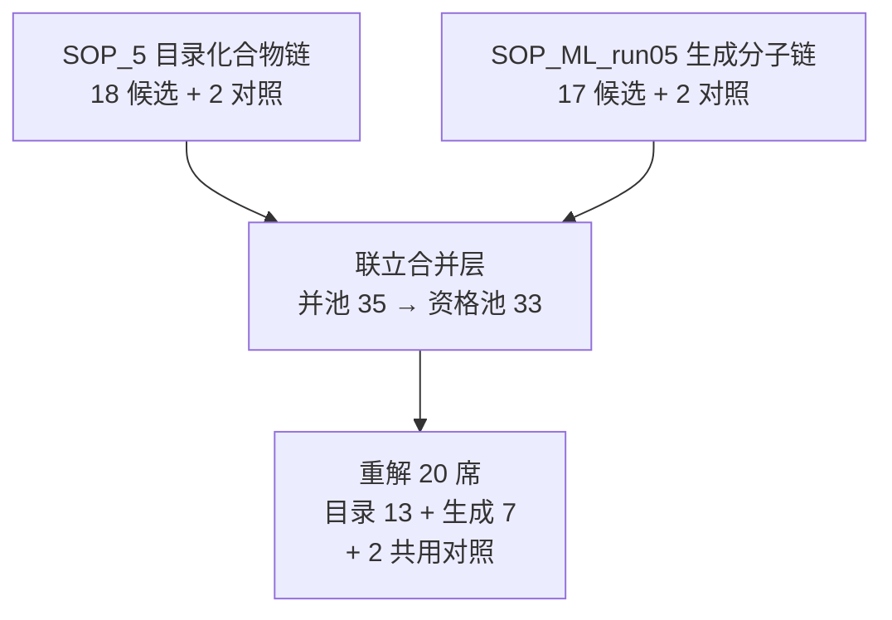

# results/ · 候选清单与交付物

本目录是**提交给评审的候选分子清单**（冻结版），与 `src/` 下的可复跑产出分开存放，
便于评审直接查阅、也便于用 `run.sh` 复跑后逐行核验。

| 路径 | 内容 |
|---|---|
| `results.csv` | **标准化候选清单（主结果文件）**：UTF-8 逗号分隔，61 行 × 31 列 |
| `results.xlsx` | 同内容 Excel（sheet `results`） |
| `SOP_5/SOP-05_MD_batch20.csv` | 目录化合物链 MD 一级批次全字段表（20 行 = 18 候选 + 2 对照） |
| `SOP_5/SOP-05_MD_batch_excluded.csv` | 该链落选与剔除明细 |
| `SOP_5/SOP-05_MD_BATCH.md` | 该链选批说明（来源名单哈希、配额、最优性证书读数） |
| `SOP_5/SOP-05_md_batch.json` | 该链最优性证书与口径自描述（含输入 sha256） |
| `SOP_5/figures/` | 该链批次图（PNG + SVG） |
| `SOP_ML_run05/…` | 同上，ML 生成分子链（19 行 = 17 候选 + 2 对照） |
| `merged_final_md/final_md_20.csv` | **联立合并层最终名册**（22 行 = 20 候选 + 2 共用对照，含来源、可合成性分诊带） |
| `merged_final_md/final_md_excluded.csv` | 合并层落选/剔除明细（15 行） |
| `merged_final_md/final_md.json` | 合并层自描述：口径、最优性证书、席位角色、敏感性对照、输入哈希 |
| `merged_final_md/FINAL_MD_20.md` | 合并层小结（含「如何解读本层读数」） |
| `merged_final_md/figures/` | 22 张结构卡图 + 批次构成三联图（PNG + SVG） |
| `reproduced/` | `run.sh` 复跑产出（用于一致性核验，**非提交内容**） |

## 三套清单的关系

- 三条链共用**同一套**冻结规则 `SOP-05-A2A-antagonist-shortlist v1.7.0`（阈值与门一字未改）。
- 两条链的 MD 一级批次按 InChIKey 结构**零重叠**；唯二相同的是 2 个共用阴性对照。
- 合并层是**派生分析层**：不改名单、不改门、不改规则版本，只做机时分配与留痕。
- `results.csv` 把三套并排列出（同分子在不同 `source_set` 下可能出现多次），
  **三套合计唯一分子 37 个**（= 18 + 17 + 2 对照）。

## 字段字典

见包根 `README.md` §4；口径与解读边界见 `README.md` §5，尤其是：

1. 本清单是计算结果，**不含实验数据**，不产生安全性/有效性结论；
2. hERG 只表示「在 ADMET-AI 口径下过门」，第二模型分歧分子已保留并标注；
3. 「最优」限定在批次目标函数口径内，不等于「比落选者更好」；
4. 跨来源 CNN_VS 不可直接比较（合并层已给出百分位口径的敏感性对照）。
